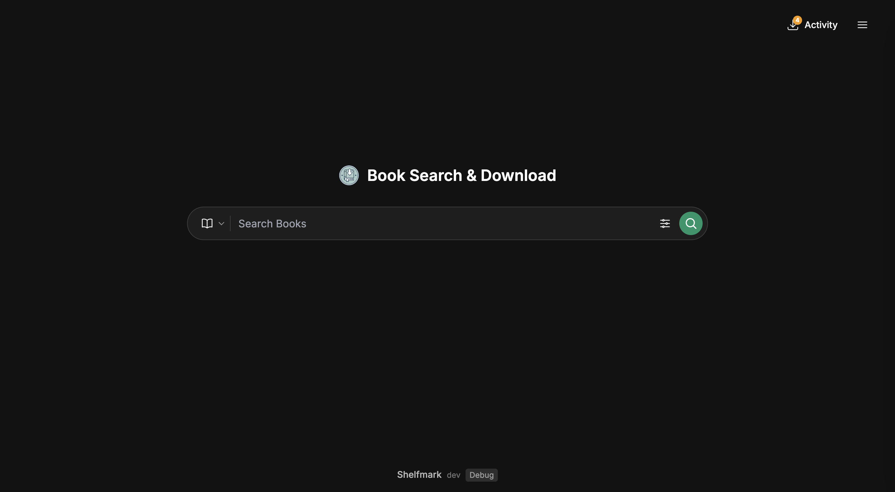
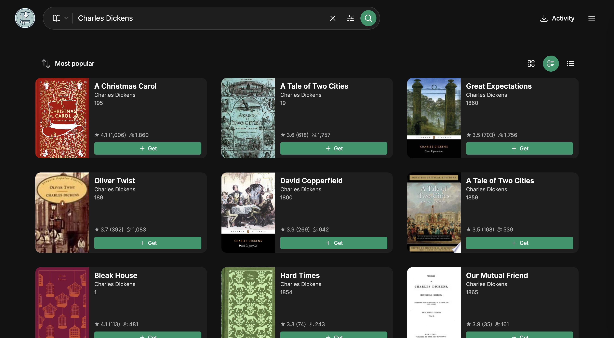
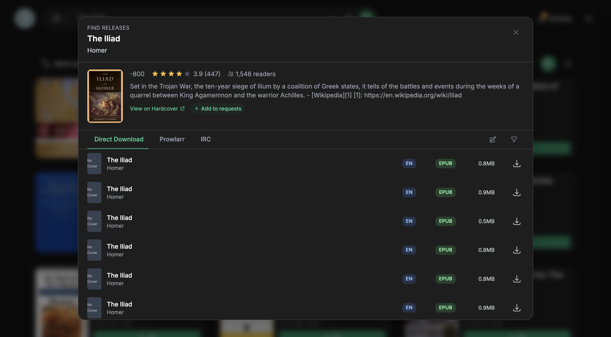
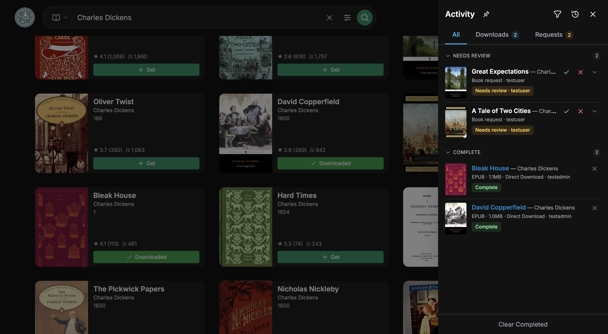

# BookFlow

<p align="center">
  
</p>

<p align="center">
  A self-hosted catalog, request, acquisition, and delivery platform for ebooks.
</p>

BookFlow brings discovery, requests, release selection, downloads, a shared
catalog, personal libraries, Kobo delivery, and operations into one web
application. You choose the metadata providers, release sources, download
clients, and library destinations; BookFlow coordinates the workflow between
them.

Version 1.0.0 is the first standalone BookFlow release.

## Highlights

- **Shared catalog and personal libraries** — Books are canonical catalog
  records backed by imported files. Library membership, file access, downloads,
  reading progress, and Kobo shelves remain scoped to each user.
- **Request lifecycle** — Users request unavailable books, administrators
  approve or reject them, and one durable request process coordinates all
  approved requesters for the same book.
- **Release profiles** — Define formats, languages, protocols, indexers, size
  limits, seed requirements, scoring rules, blocked terms, and the minimum
  automatic score.
- **Automatic and interactive search** — Automatically select the best eligible
  candidate or let an administrator inspect scores and rejection reasons,
  force-select a candidate, and retain an audit trail.
- **Multiple acquisition paths** — Direct HTTP downloads, Prowlarr/Newznab,
  torrent and usenet clients, and IRC sources can feed the same validated import
  pipeline.
- **Rich metadata** — Integrations include Hardcover, Open Library, Google
  Books, Apple Books, KB/Nationale Bibliotheek, and DBNL.
- **Discovery and monitoring** — Browse the shared catalog, search with SQLite
  FTS5, discover recent additions and Bestseller 60 suggestions, and monitor
  supported authors or series.
- **Kobo integration** — Per-device tokens, library sync, reading progress,
  durable shelf intent, verified EPUB-to-KEPUB conversion, and a Windows Kobo
  patcher with a short-lived pairing flow.
- **Multi-user authentication** — Local accounts, OIDC, trusted reverse-proxy
  authentication, and optional Calibre-Web user database synchronization.
- **PWA and notifications** — Installable web app, offline application shell,
  update prompts, and per-user web-push rules.
- **Operations built in** — Versioned database migrations, integrity checks,
  encrypted backups, staged restore, health/readiness endpoints, metrics,
  structured redacted logging, and administrative audit views.
- **Hardened processing** — Entitlement checks, CSRF/origin protection, SSRF
  controls, path confinement, archive limits, idempotent jobs, and secret
  redaction are enforced server-side.

## Screenshots

| Home | Search results |
| --- | --- |
|  |  |

| Multiple sources | Download activity |
| --- | --- |
|  |  |

## Docker images

Release tags publish attested multi-architecture images for `linux/amd64` and
`linux/arm64` to GitHub Container Registry.

| Image | Purpose |
| --- | --- |
| `ghcr.io/timminater/bookflow` | Full image with built-in Chromium browser automation |
| `ghcr.io/timminater/bookflow-lite` | Smaller image for external bypassers or sources that do not need browser automation |

Published version tags include `latest`, `1.0.0`, `1.0`, `v1.0.0`, and a
commit-SHA tag. Production deployments should use a version tag or, preferably,
the immutable digest shown by GHCR.

## Quick start with Docker Compose

Download the standard Compose file:

```bash
curl -O https://raw.githubusercontent.com/Timminater/BookFlow/main/compose/docker-compose.yml
```

Create `.env` beside it:

```dotenv
BOOKFLOW_IMAGE=ghcr.io/timminater/bookflow:1.0.0
```

Start BookFlow:

```bash
docker compose config
docker compose up -d
```

Open `http://localhost:8084` and create the first administrator account.

For an immutable production pin, replace the version tag with the digest
published by GHCR:

```dotenv
BOOKFLOW_IMAGE=ghcr.io/timminater/bookflow@sha256:<release-digest>
```

## Unraid

Create a Docker container with these core settings:

| Unraid setting | Value |
| --- | --- |
| Repository | `ghcr.io/timminater/bookflow:latest` |
| Network type | `bridge` |
| Web UI port | Host `8084` → container `8084` |
| Appdata | `/mnt/user/appdata/bookflow` → `/config` |
| Books/library ingest | Your library path → `/books` |
| `PUID` / `PGID` | The owner of the mapped host directories, commonly `99` / `100` on Unraid |
| `TZ` | Your IANA timezone, for example `Europe/Amsterdam` |

The `latest` tag makes Unraid update checks convenient. For controlled
production upgrades, use `ghcr.io/timminater/bookflow:1.0.0` or an immutable
digest and change it deliberately after taking a backup.

The repository and initial GHCR package may be private. In that case, sign in
on the Unraid host with a GitHub token that has `read:packages`:

```bash
echo "$GHCR_TOKEN" | docker login ghcr.io -u Timminater --password-stdin
```

Useful optional mappings:

- Mount the exact path reported by qBittorrent, Transmission, SABnzbd, NZBGet,
  Deluge, or rTorrent when BookFlow must import completed client downloads.
- Mount a read-only Calibre-Web database at `/auth/app.db` when using
  Calibre-Web authentication synchronization.
- Keep `/config/backups`, `/config/.restore-staging`, `/config/kepub-cache`,
  and `/config/patcher-cache` inside protected appdata.

Do not place the SQLite database on an SMB/NFS share or run multiple BookFlow
writers against the same `/config` directory.

## Volumes and permissions

```yaml
volumes:
  - /path/to/bookflow-config:/config
  - /path/to/library-or-ingest:/books
  # Optional: must match the path reported by an external download client.
  - /path/to/downloads:/data/downloads
```

- `/config` stores settings, the SQLite database, artwork, conversion caches,
  backups, and restore staging.
- `/books` is the default destination for validated imported files.
- Torrent and usenet clients must expose the same container path to BookFlow,
  or require a configured remote-path mapping.
- The mapped directories must be writable by the configured `PUID` and `PGID`.
- A fixed non-root runtime is also supported with UID/GID `1000:1000`.
- Tor and WireGuard modes require root startup and the documented network
  capabilities.

Point `/books` at the ingest directory of tools such as Calibre,
Calibre-Web-Automated, Booklore, or another library manager when you want
completed books imported automatically.

## Configuration

Most settings can be managed from the administration interface. Environment
variables are useful for container bootstrap and locked deployment values.

| Variable | Default | Purpose |
| --- | --- | --- |
| `FLASK_PORT` | `8084` | HTTP port inside the container |
| `CONFIG_DIR` | `/config` | Persistent configuration and database directory |
| `INGEST_DIR` | `/books` | Default completed-book destination |
| `PUID` / `PGID` | `1000` / `1000` | Runtime file ownership in root-startup mode |
| `TZ` | `UTC` | Container timezone |
| `BASE_PATH` | empty | Optional reverse-proxy subpath |
| `USING_TOR` | `false` | Route supported traffic through the built-in Tor mode |
| `USING_WIREGUARD` | `false` | Enable WireGuard with a fail-closed kill switch |
| `VAPID_PUBLIC_KEY` | unset | Browser web-push public key |
| `VAPID_PRIVATE_KEY` | unset | Server-only web-push private key |
| `VAPID_SUBJECT` | unset | `mailto:` or HTTPS VAPID contact |
| `BACKUP_ENCRYPTION_KEY` | unset | Enable authenticated encryption for backup archives |

See the [environment variable reference](docs/environment-variables.md) for
the complete list.

## Core workflow

1. Metadata discovery creates or resolves a canonical Book.
2. A fileless Book can be requested but cannot enter a user's library.
3. An administrator approves the request; requests for the same Book share one
   request process.
4. The selected release profile is snapshotted for deterministic processing.
5. Automatic search selects the highest eligible candidate, or an administrator
   uses interactive search.
6. Durable jobs download, validate, extract, organize, and import files.
7. Imported files make the Book catalog-visible, fulfil approved requests,
   grant per-user entitlements, and apply saved Kobo-sync intent.

## Authentication and access

BookFlow supports:

- local usernames and passwords;
- OpenID Connect with discovery, PKCE, automatic provisioning, and optional
  group-based administrator mapping;
- trusted reverse-proxy headers;
- read-only Calibre-Web `app.db` synchronization.

Administrator status and library capability are separate. A user can be
download-capable or request-only. File serving, libraries, requests, downloads,
Kobo shelves, and progress are always checked against the authenticated actor
and stored entitlements.

When proxy authentication is enabled, expose BookFlow only through the trusted
proxy and make the proxy strip and replace identity headers.

## Kobo and KEPUB

BookFlow provides a Kobo-compatible API under a per-device secret URL. The
Reader settings page can create a ten-minute pairing code for the Windows
patcher, which changes only Kobo's `api_endpoint` setting and keeps recoverable
backups.

Official images bundle and verify `kepubify` for both supported architectures.
Derived KEPUB files are cached by source checksum, converter version, and
options hash, validated before publication, and linked to their source EPUB.

See [Kobo and platform features](docs/platform-features.md) and
[KEPUB conversion](docs/kepub.md).

## Backups, upgrades, and rollback

BookFlow can create manual and scheduled backups containing a consistent SQLite
snapshot, configuration files, and a checksum manifest. Set
`BACKUP_ENCRYPTION_KEY` to encrypt backup archives with AES-GCM.

Before upgrading:

1. Create and verify a backup.
2. Record the currently deployed image digest.
3. Pull the reviewed new version or digest.
4. Start BookFlow and verify health, login, library access, and one acquisition
   path.

Never run an older image against a database migrated by a newer version.
Restore the matching pre-upgrade `/config` backup before rolling back.

See [deployment operations](docs/deployment.md) and
[database migrations](docs/dev/database-migrations.md).

## Health and observability

- Liveness: `GET /api/health`
- Readiness and maintenance state are exposed separately to prevent a partially
  initialized instance from being treated as ready.
- Structured logs redact credential-shaped values and bearer/query secrets.
- Administrative operations expose bounded metrics, migration state, backup
  status, and durable-job health.

Container logs remain available through:

```bash
docker logs bookflow
```

## Development

Requirements:

- Python 3.14
- Node.js 24
- `uv`
- Docker with Buildx for image verification

```bash
# Python environment
uv sync --locked --extra browser

# Backend quality and tests
make python-checks
make python-test

# Frontend
cd src/frontend
npm ci
npm run typecheck
npm run lint
npm run format:check
npm run test:unit
npm run build
```

Local development commands and demo data are documented in
[AGENTS.md](AGENTS.md). The full documentation index is available at
[docs/index.md](docs/index.md).

## Releases

Pushing a semantic version tag such as `v1.0.0` runs the Docker publication
workflow. It:

- builds the full and lite targets;
- publishes AMD64 and ARM64 manifests to GHCR;
- generates SBOM and provenance attestations;
- publishes version, `latest`, and commit-SHA tags.

The Windows Kobo patcher has its own tagged-release workflow with checksums and
an SPDX SBOM. Authenticode signing is enabled when the required repository
secrets are configured.

## License

BookFlow is distributed under the [MIT License](LICENSE).

## Responsible use

BookFlow does not provide hosted content. It connects only to sources and
services configured by the operator. You are responsible for complying with
the laws, licenses, provider terms, and access rights that apply in your
jurisdiction.

## Support

Use [GitHub Issues](https://github.com/Timminater/BookFlow/issues) for bug
reports and reproducible technical problems.

## Acknowledgement

BookFlow was originally based on the open-source
[Shelfmark](https://github.com/calibrain/shelfmark) project. BookFlow is now
developed and released as its own project.
